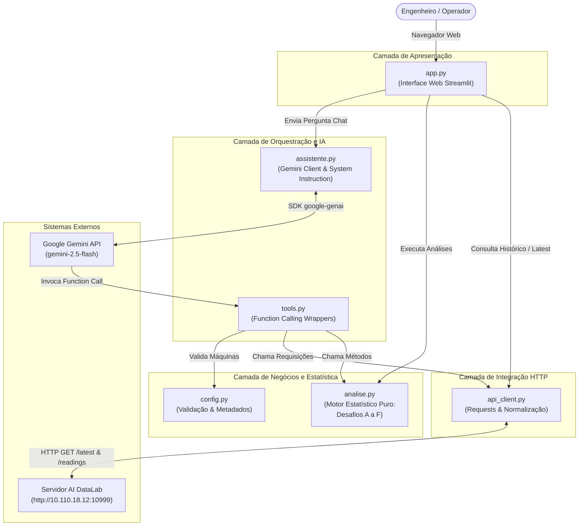
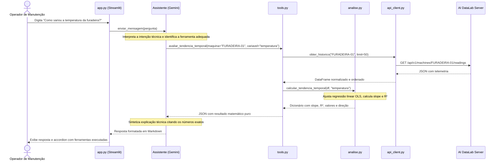

# Arquitetura e Engenharia de Software da Solução
**Célula de Usinagem Inteligente: CENTRO-USINAGEM-01 e FURADEIRA-01**  
*Módulo 3: Linguagem de Programação • Aula 04*

---

## 1. Visão Geral da Arquitetura

A solução foi projetada sob o princípio da **separação estrita de responsabilidades (Separation of Concerns - SoC)** e **computação determinística**, garantindo que nenhum cálculo estatístico ou decisão crítica de engenharia dependa da capacidade aritmética estocástica de modelos generativos (LLMs).

A arquitetura organiza-se em 4 camadas bem delimitadas:
1. **Camada de Apresentação (Frontend Interativo):** Desenvolvida em Streamlit (`app.py`), fornecendo dashboard em tempo real, gráficos de séries temporais e interface conversacional.
2. **Camada de Orquestração Cognitiva (IA & Function Calling):** Composta por `assistente.py` e `tools.py`, integrando o Google GenAI SDK com mapeamento automático de ferramentas Python.
3. **Camada de Negócio e Análise Numérica (Motor Determinístico):** Implementada em `analise.py`, executa algoritmos estatísticos puros (comportamento habitual, regularidade, outliers IQR, regressão linear OLS e comparação pareada).
4. **Camada de Integração e Acesso a Dados (HTTP Client):** Implementada em `api_client.py` com suporte à API do AI DataLab e contingência didática.

---

## 2. Diagrama de Componentes

---

## 3. Diagrama de Sequência: Ciclo de Consulta com Function Calling

O fluxo abaixo demonstra como uma dúvida em linguagem natural é convertida em dados determinísticos sem risco de alucinação numérica:

---

## 4. Princípios de Segurança e Boas Práticas

### 4.1. Isolamento de Credenciais
A chave `GEMINI_API_KEY` é consumida exclusivamente a partir do ambiente (`os.getenv`) ou de um campo de senha seguro com máscara na interface web. Nenhum token, senha ou credencial é gravado em disco, garantindo conformidade com a Seção 7 do regulamento.

### 4.2. Operação Estritamente Somente-Leitura (Read-Only)
Nenhum endpoint ou função aceita métodos `POST`, `PUT` ou `DELETE` capazes de alterar parâmetros de máquina, atuar sobre relés ou enviar comandos para os inversores. A aplicação limita-se à telemetria passiva.

### 4.3. Validação Estrita de Identificadores (Whitelist)
A função `validar_maquina()` atua como barreira de segurança perimetral em todos os módulos. Qualquer tentativa de injeção de identificadores não autorizados (como `BOMBA-01`, comandos shell ou outros equipamentos) é rejeitada de imediato com `ValueError`.

### 4.4. Resiliência Operacional com Fallback Didático
Reconhecendo que a rede interna do laboratório (`10.110.18.12`) não está acessível fora das instalações físicas da instituição, a camada `api_client.py` conta com um gerador determinístico de contingência que simula rigorosamente as variáveis, taxas de amostragem e os cenários investigativos da aula prática, garantindo que o software permaneça 100% testável e demonstrável em qualquer ambiente.
